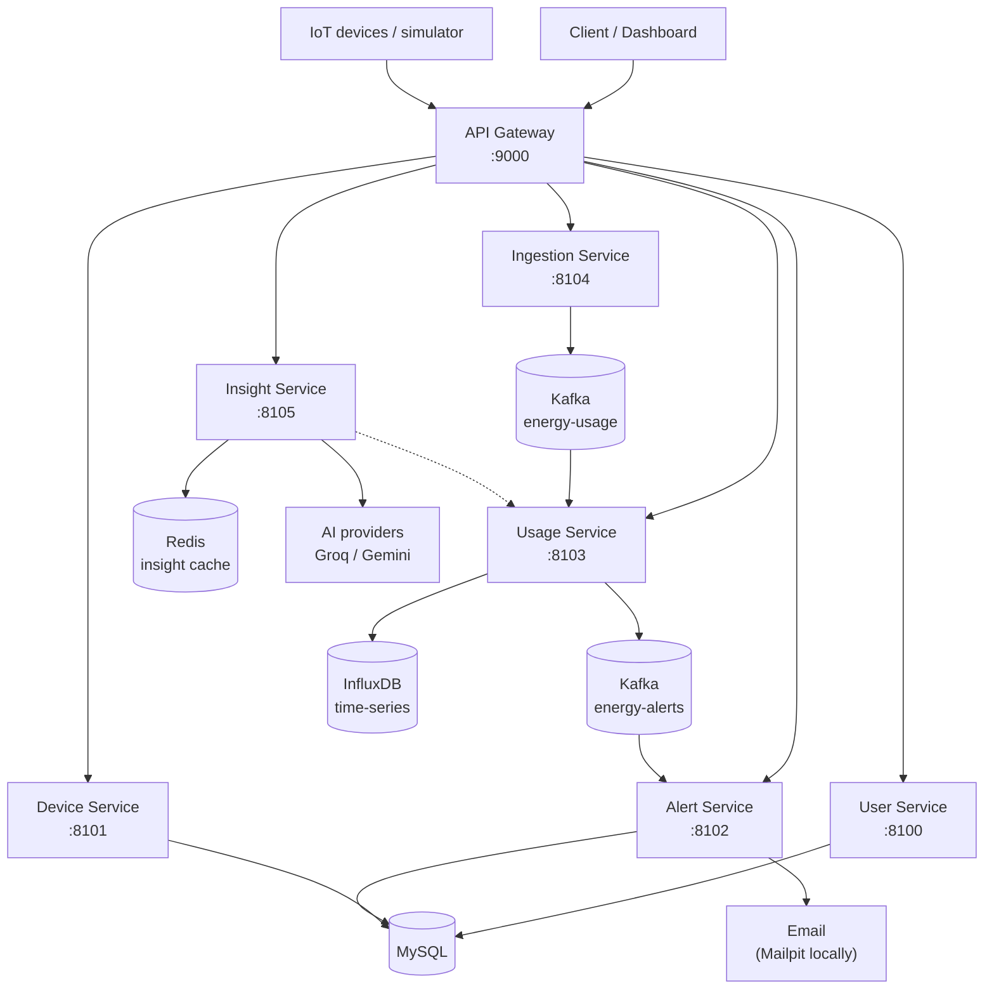

# Energy Tracker

A home energy monitoring platform. Devices report power readings, the system
stores them as time-series, checks them against a limit you set, emails you the
moment a device crosses that limit, and an AI reads your own usage history to
stream practical saving tips.

Built as an event-driven Spring Boot microservices backend with a Next.js
dashboard.

> **Live demo:** https://tracker-chi-swart.vercel.app
> The full stack needs MySQL, Kafka, InfluxDB and Redis, so it is not hosted.
> The live link is a self-contained demo of the product UI with a mocked API.
> See [Live demo vs. full stack](#live-demo-vs-full-stack).

---

## Table of contents

- [Why this project](#why-this-project)
- [Live demo vs. full stack](#live-demo-vs-full-stack)
- [Architecture](#architecture)
- [Services](#services)
- [Tech stack](#tech-stack)
- [How a reading flows](#how-a-reading-flows)
- [Getting started](#getting-started)
- [What's seeded on first run](#whats-seeded-on-first-run)
- [Features](#features)
- [Engineering highlights](#engineering-highlights)
- [API reference](#api-reference)
- [Testing](#testing)
- [Project structure](#project-structure)
- [Troubleshooting](#troubleshooting)
- [Security notes and limitations](#security-notes-and-limitations)

---

## Why this project

Homeowners only learn which appliance is driving the bill when the utility bill
arrives — a month after the fact, far too late to act. Smart-meter data is
high-frequency and useless raw; the value is in turning it into three answers,
in near real time:

1. **How much am I using?** — live totals and hour/day trends for the whole home.
2. **Which device is the culprit?** — per-device breakdown and rankings.
3. **What do I do about it?** — AI saving tips grounded in your own history.

The design follows from the workloads. Ingestion is write-heavy and bursty,
dashboard queries are cheap and frequent, AI generation is slow and
quota-limited, and alerting must fire even when everything else is degraded.
Those have different scaling and failure profiles, which is why the system is
split into independently deployable services behind a single gateway rather
than one monolith.

---

## Live demo vs. full stack

The complete system depends on MySQL, Kafka, InfluxDB and Redis, so hosting it
for free is not practical. Two repositories cover both goals:

| | Full stack (this repo) | Live demo |
|---|---|---|
| Repository | `Nayyelin-14/energy-tracker` | [`Nayyelin-14/tracker`](https://github.com/Nayyelin-14/tracker) |
| Live URL | — (runs locally) | https://tracker-chi-swart.vercel.app |
| Runtime | 7 Spring Boot services + Next.js | one Next.js app (Vercel free tier) |
| Storage | MySQL, InfluxDB | none — data regenerated per request |
| Messaging | Apache Kafka | synchronous function call |
| AI | Spring AI (Groq / Gemini) | rule-based text |

The demo reimplements the same API surface as Next.js Route Handlers, so the
dashboard, alerting rules, SSE streaming and error contract behave the same with
zero infrastructure.

---

## Architecture



**Data-flow summary**

1. Clients and devices talk only to the **API Gateway**, which routes to each
   service and protects the system with circuit breakers and fallbacks.
2. **User** and **Device** services own relational data in **MySQL**.
3. **Ingestion** validates readings and publishes them to the `energy-usage`
   Kafka topic.
4. **Usage** consumes them, stores time-series points in **InfluxDB**, and
   publishes threshold breaches to `energy-alerts`.
5. **Alert** consumes breaches, persists them, and sends a single email per
   crossing.
6. **Insight** reads usage aggregates and calls an AI provider, with a Redis
   cache, concurrency limits and per-user rate limiting.

---

## Services

| Service | Port | Responsibility | Storage |
|---|---|---|---|
| **api-gateway** | 9000 | Single entry point, routing, Resilience4j circuit breakers, fallbacks | — |
| **user-service** | 8100 | Registration, profile, threshold settings (BCrypt, unique email), owns Flyway migrations | MySQL |
| **device-service** | 8101 | Device registry CRUD | MySQL |
| **alert-service** | 8102 | Consumes `energy-alerts`, persists alerts, sends email | MySQL |
| **usage-service** | 8103 | Consumes `energy-usage`, stores time-series, computes aggregates, publishes breaches | InfluxDB |
| **ingestion-service** | 8104 | Validates readings, publishes to Kafka, seeds demo data, simulation endpoints | — |
| **insight-service** | 8105 | AI saving tips, SSE streaming, cache, rate limits, provider catalog | Redis (cache) |
| **web-view** | 3000 | Next.js dashboard | — |

Each service is an independent Spring Boot application with its own
configuration. No service reaches into another service's database.

---

## Tech stack

**Backend**

| Technology | Version | Use |
|---|---|---|
| Java | 25 (enforced) | Runtime |
| Spring Boot | 4.1.1 | Service framework |
| Spring Cloud Gateway | 2025.1.3 | API gateway |
| Resilience4j | via Spring Cloud | Circuit breakers, fallbacks |
| Spring AI | 2.0.1 | LLM integration |
| Spring Data JPA + Hibernate | via Boot | Relational data |
| MySQL | 8 | Users, devices, alerts |
| Apache Kafka | latest | Event bus |
| InfluxDB | 2.7 | Time-series readings |
| Redis | Upstash-compatible | Insight cache |
| Mailpit | latest | Local SMTP inbox |
| springdoc-openapi | 3.0.2 | API docs |
| Maven Wrapper | — | Build without a local Maven |

**Frontend**

| Technology | Use |
|---|---|
| Next.js 16 (App Router) | Dashboard |
| React 19 | UI |
| TypeScript | Types |
| Tailwind CSS 4 | Styling |
| Recharts | Charts |
| Framer Motion | Motion |

> **JDK 25 is mandatory.** The parent POM's Enforcer plugin fails the build on
> any other JDK, and requires Maven 3.9+.

---

## How a reading flows

1. A device or simulator sends a reading (device ID, watts, timestamp) to the
   **Ingestion Service**, which validates it and publishes an
   `EnergyUsageEvent` to Kafka. The client gets `202 Accepted` immediately.
2. The **Usage Service** consumes the event and writes a point to InfluxDB
   (bucket `usage-bucket`, measurement `energy-usage`).
3. Aggregates (hourly / daily kWh) are computed on read. When a user's total
   crosses their threshold, the Usage Service publishes an `AlertingEvent` to
   `energy-alerts`.
4. The **Alert Service** consumes the breach, stores it, and sends an email.
   Alerting is **edge-triggered**: one notification when usage crosses the
   limit, silence while it stays high, re-armed when it drops back under.
5. The dashboard reads trends, alerts and insights through the **API Gateway**.

---

## Getting started

### Prerequisites

- **Docker** (runs MySQL, Kafka, InfluxDB, Mailpit, Kafka UI)
- **JDK 25**
- **Node.js 20+** (dashboard only)
- Optional for AI: `GROQ_API_KEY` and/or `GEMINI_API_KEY`

### 1. Configure environment

```bash
cp backend/.env.example backend/.env          # then fill in your API keys
cd web-view && cp .env.example .env.local      # gateway URL; the default is fine
```

`backend/.env` is gitignored. The insight service loads it automatically at
startup — no `source` needed. Real environment variables always override it.

### 2. Start everything

```bash
cd backend
./start-all.sh --frontend
```

This boots Docker infra, then all seven services in dependency order, waits for
real health signals (not just open ports), seeds the demo home, and finally
starts the dashboard.

**Manual start** (one terminal per service — order matters; user-service runs
Flyway first):

```bash
docker compose up -d

cd user-service      && ./mvnw spring-boot:run   # :8100
cd device-service    && ./mvnw spring-boot:run   # :8101
cd alert-service     && ./mvnw spring-boot:run   # :8102
cd usage-service     && ./mvnw spring-boot:run   # :8103
cd ingestion-service && ./mvnw spring-boot:run   # :8104  (seeds the demo home)
cd api-gateway       && ./mvnw spring-boot:run   # :9000  entry point
cd insight-service   && ./mvnw spring-boot:run   # :8105  AI

cd web-view && npm install && npm run dev        # :3000
```

Logs (when using the script): `backend/logs/<service>.log`.

### 3. URLs

| URL | What |
|---|---|
| http://localhost:3000 | The dashboard |
| http://localhost:9000 | API gateway |
| http://localhost:8025 | Mailpit inbox (alert emails land here) |
| http://localhost:8070 | Kafka UI |
| http://localhost:8072 | InfluxDB (raw readings) |

### 4. Stop

```bash
./stop-all.sh            # stop services
./stop-all.sh --infra    # also stop Docker containers
```

---

## What's seeded on first run

The ingestion seeder is idempotent (safe to restart) and creates:

- **Demo user** — `demo@energytracker.dev` / `Demo123!` (name: Demo User)
- **Three demo devices**
- **Seven days** of realistic readings with a day/night curve and an evening peak
- **Threshold: 500**, alerting **ON**

You never log in. The dashboard picks the demo user up automatically. If you see
"Demo session not initialized", the seeder has not run yet — start the ingestion
service.

---

## Features

| Page | What you can do |
|---|---|
| **Overview** | KPI row (total consumed + sparkline, device count, threshold arm/mute, average per day), hourly/daily consumption chart with the limit as a dashed line, energy-by-device ranking, recent devices and incidents. Partial failures show a "Partial data" banner with retry while the rest keeps working. |
| **Devices** | Cards grouped by type; detail drawer; add, edit and delete (past usage stays in InfluxDB, only the device goes). Validation errors as RFC 7807 problem details with field messages. |
| **Alerts** | Counters for total events, threshold breaches and pending emails; filters All / Violations / Unsent; each row shows load vs. limit, email status and time. |
| **Simulation** | Edit the system-wide threshold and the alerting switch (save enables only when changed); dispatch a **normal** batch (no breach) or a **high spike** (guaranteed violation); watch the pipeline log go `queued → ok`. |
| **Insights** | Choose output mode (streamed saving tips or one-shot overview), provider/model from the live catalog, and a 3/7/30-day window. Streaming types token by token with a live token/latency footer; repeat requests are cache hits. |

---

## Engineering highlights

- **Event-driven ingestion** — Kafka decouples write bursts from processing so
  ingestion stays fast and alerts are processed in order.
- **Resilience by design** — per-service Resilience4j circuit breakers
  (count-based window, automatic half-open) with gateway fallbacks, so one
  struggling service degrades gracefully instead of hanging the app.
- **Edge-triggered alerting** — one email per threshold crossing, not a stream
  of repeats; re-arms when usage drops or the threshold changes.
- **Time-series storage** — readings in InfluxDB with hourly/daily aggregation
  on read; relational data (users, devices, alerts) stays in MySQL.
- **Hardened AI service** — Server-Sent Events token streaming, an 11 s
  full-lifecycle deadline, at most 8 concurrent generations, single-flight
  dedup for identical requests, a 15-minute Redis cache, and per-user rate
  limits (1 per 10 s, 20 per hour). Cache hits consume no quota.
- **Multi-provider AI** — Groq (default) and Google Gemini, with a live provider
  catalog that only exposes providers whose API key is configured.
- **Consistent errors** — RFC 7807 `application/problem+json` across services.
- **Reproducible local demo** — one command brings up infra, all services,
  health gates, seed data and the dashboard.

**Capacity design (estimates, not benchmarks):** at 500k users × 5 devices and
one reading per device per minute, average throughput is ≈ **41,700
readings/second** (≈ **3.6B readings/day**). At 72 bytes/reading that is
≈ **259 GB/day**, ≈ **7.8 TB per 30 days** before index/replication/compression
overhead — which drives Kafka partitioning, batched writes and retention
choices.

---

## API reference

All paths are reachable through the gateway on `:9000`.

**User**

| Method | Path |
|---|---|
| `GET` | `/api/v1/user/demo` |
| `GET` | `/api/v1/user/{userId}` |
| `GET` | `/api/v1/user/email/{email}` |
| `POST` | `/api/v1/user/register` |
| `PUT` | `/api/v1/user/{userId}` |
| `DELETE` | `/api/v1/user/{userId}` |

**Device**

| Method | Path |
|---|---|
| `GET` | `/api/v1/device` |
| `GET` | `/api/v1/device/{deviceId}` |
| `GET` | `/api/v1/device/user/{userId}` |
| `POST` | `/api/v1/device/create` |
| `PUT` | `/api/v1/device/{deviceId}` |
| `DELETE` | `/api/v1/device/{deviceId}` |

**Usage**

| Method | Path |
|---|---|
| `GET` | `/api/v1/usage/{userId}?days=` |
| `GET` | `/api/v1/usage/{userId}/series?days=&interval=hour\|day` |
| `GET` | `/api/v1/usage/{userId}/coverage` |

**Alert**

| Method | Path |
|---|---|
| `GET` | `/api/v1/alert/user/{userId}` |

**Ingestion**

| Method | Path |
|---|---|
| `POST` | `/api/v1/ingestion` |
| `POST` | `/api/v1/ingestion/simulate/device/{deviceId}?mode=normal\|high` |

**Insight**

| Method | Path |
|---|---|
| `GET` | `/api/v1/insight/providers` |
| `GET` | `/api/v1/insight/saving-tips/{userId}` |
| `GET` | `/api/v1/insight/saving-tips/stream/{userId}` *(SSE)* |
| `GET` | `/api/v1/insight/overview/{userId}` |

**Examples**

```bash
curl http://localhost:9000/api/v1/user/demo
curl "http://localhost:9000/api/v1/usage/<userId>/series?days=7&interval=hour"
curl -N http://localhost:9000/api/v1/insight/saving-tips/stream/<userId>
curl -X POST "http://localhost:9000/api/v1/ingestion/simulate/device/<deviceId>?mode=high"
```

---

## Testing

```bash
cd backend

cd insight-service && ./mvnw test    # streaming, rate limits, cache, deadline
cd device-service  && ./mvnw test
cd alert-service   && ./mvnw test    # end-to-end: Kafka -> DB -> email (needs infra up)
```

Test coverage spans unit tests, controller tests, and a true end-to-end alert
test that carries a breach from an incoming reading to a delivered email. Most
integration tests need the Docker infrastructure running.

---

## Project structure

```
energy-tracker/
├── backend/
│   ├── pom.xml                 # parent aggregator + shared dependency management
│   ├── docker-compose.yaml     # MySQL, Kafka, Kafka UI, InfluxDB, Mailpit
│   ├── start-all.sh            # infra + services + health gates (+ --frontend)
│   ├── stop-all.sh
│   ├── .env.example            # copy to .env (gitignored) and fill in keys
│   ├── docs/architecture.md
│   ├── api-gateway/            # :9000  Spring Cloud Gateway + circuit breakers
│   ├── user-service/           # :8100  profile + threshold, MySQL, Flyway
│   ├── device-service/         # :8101  device registry
│   ├── alert-service/          # :8102  alerts + email
│   ├── usage-service/          # :8103  time-series + aggregates
│   ├── ingestion-service/      # :8104  readings -> Kafka, demo seeder, simulation
│   └── insight-service/        # :8105  AI saving tips, SSE, cache
├── web-view/                   # Next.js 16 dashboard (:3000)
├── GUIDE.md                    # full user guide
└── STACK.md                    # Java -> MySQL persistence stack notes
```

---

## Troubleshooting

| Symptom | Fix |
|---|---|
| "API gateway unreachable" | Gateway not up: check `backend/logs/api-gateway.log` and `:9000/actuator/health` |
| "Demo session not initialized" | The ingestion seeder has not run yet — start ingestion-service |
| Port already in use | `start-all.sh` preflight names the port; free it or run `stop-all.sh` |
| MySQL won't start | Host MySQL occupies 3306; this project uses **3307** (set `MYSQL_PORT`) |
| Insights shows no providers | No API keys: fill `backend/.env` and restart insight-service |
| `429` on insights | Working as designed — wait, or reuse a cached question |
| Data vanished after restart | The seeder deletes and rewrites demo readings on purpose |

---

## Security notes and limitations

- **Not production-hardened.** The insight service has no authentication and
  trusts the `userId` path parameter, so any caller can read any user's insights
  and spend the shared AI quota. Before any real deployment, place it behind an
  authenticated gateway that injects/validates the user identity.
- Local database credentials live in `docker-compose.yaml` and `.env.example`
  for convenience; supply real secrets via environment variables.
- This project is intended for local development and portfolio demonstration.

---

## License

Not yet specified. Treat the source as all rights reserved unless a license is
added.
