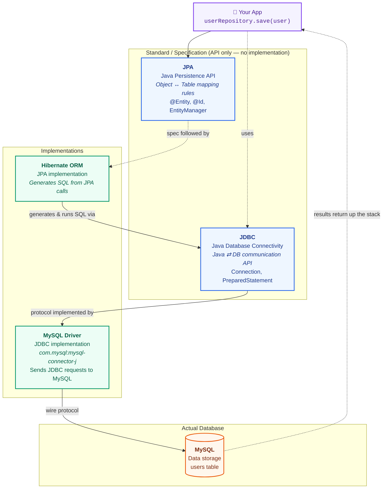
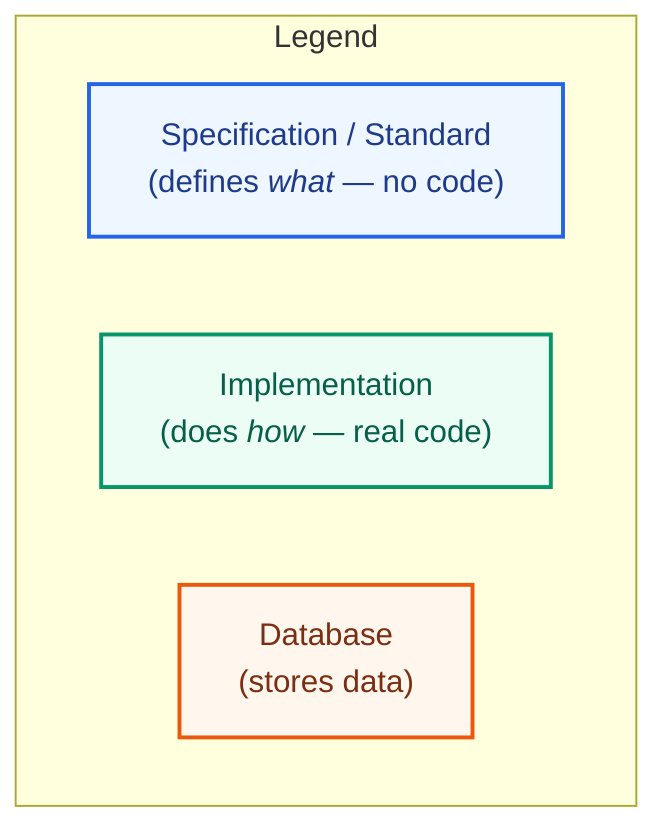

# Java → MySQL Stack

## How the pieces fit together (request flow)

## What is what?

| Thing                 | Full name                  | ဘာလဲ?                              | အဓိကအလုပ်                                                         | Sample usage                                      |
| --------------------- | -------------------------- | ---------------------------------- | ----------------------------------------------------------------- | ------------------------------------------------- |
| **JPA**               | Java Persistence API       | Standard / specification           | Java Object ↔ DB Table mapping အတွက် standard                     | `@Entity`, `@Id`, `EntityManager`                 |
| **Hibernate**         | Hibernate ORM              | JPA implementation                 | JPA instructions ကို တကယ်အလုပ်လုပ်အောင်လုပ်ပြီး SQL generate      | `userRepository.save(user)` နောက်ကွယ်မှာအလုပ်လုပ် |
| **JDBC**              | Java Database Connectivity | Java database API                  | Java application က DB ကို communicate လုပ်နိုင်အောင် standard API | `Connection`, `PreparedStatement`                 |
| **MySQL Driver**      | MySQL JDBC Driver         | MySQL-specific implementation       | JDBC request ကို MySQL ဆီ တကယ်ပို့                             | Maven: `com.mysql:mysql-connector-j`             |
| **MySQL**             | —                          | Actual database                    | Data သိမ်းထားတဲ့နေရာ                                              | `users` table                                     |

<!--
JPA
→ "Java object နဲ့ DB table ကို ဘယ်လို map မလဲဆိုတဲ့ standard"

Hibernate
→ "JPA ကို တကယ်အလုပ်လုပ်အောင်လုပ်ပြီး SQL ထုတ်ပေးတဲ့ ORM"

JDBC
→ "Java application နဲ့ database ကြား database API"

MySQL Driver
→ "JDBC နဲ့ MySQL ကြား bridge"

MySQL
→ "Data တကယ်သိမ်းတဲ့ database" -->
