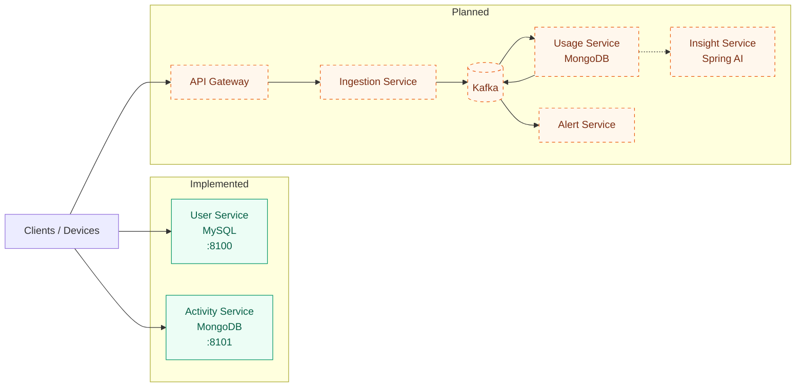

# Home Energy Tracker

A Spring Boot 4 microservices project for monitoring household energy consumption. Devices (or simulated sensors) submit power readings; the backend stores consumption data, tracks trends over time, detects unusual usage, and produces energy-saving insights.

**Main features**

- User registration with unique-email enforcement, password confirmation, and BCrypt hashing
- Input validation and consistent JSON error responses (`400`, `409`)
- Per-request logging (`POST /api/v1/user/register -> 409 (23 ms)`) and security response headers
- Service skeletons with separate databases per service (MySQL, MongoDB)

> **Status:** User Service (registration + profile) is implemented; Activity Service is a working skeleton. The architecture below shows the target design — remaining services are planned (dashed).

---

## Architecture

| Service           | Responsibility                                    | Database    | Status      |
| ----------------- | ------------------------------------------------- | ----------- | ----------- |
| **User Service**  | Registration, profile, password hashing           | MySQL       | Implemented |
| **Activity Service** | Skeleton for activity/energy data features     | MongoDB     | Skeleton    |
| **Ingestion Service** | Accept readings, publish events to Kafka       | —           | Planned     |
| **Usage Service** | Persist time-series readings, compute aggregates  | MongoDB     | Planned     |
| **Alert Service** | Detect unusual consumption, notify users          | MySQL       | Planned     |
| **Insight Service** | AI-powered energy-saving recommendations (Spring AI) | —        | Planned     |
| **API Gateway**   | Single entry point, routing, JWT validation       | —           | Planned     |



**Why microservices:** ingestion load (thousands of readings/second), user-facing queries, and AI workloads scale differently and must fail independently. Each service owns its own database — no cross-service table access.

---

## Tech Stack

| Technology              | Purpose                          | Status    |
| ----------------------- | -------------------------------- | --------- |
| Java 25                 | Runtime                          | Active    |
| Spring Boot 4.1.1       | Service framework                | Active    |
| Spring Web MVC + Bean Validation | REST APIs and input checks | Active    |
| Spring Security Crypto  | BCrypt password hashing          | Active    |
| Spring Data JPA + MySQL    | Relational user data        | Active    |
| Spring Data MongoDB     | Document / time-series storage   | Active (skeleton) |
| Maven Wrapper (`mvnw`)  | Builds without local Maven       | Active    |
| Kafka, Spring Cloud Gateway, Spring AI, Docker, Prometheus/Grafana | Pipeline, edge, AI, infra, observability | Planned |

---

## Data Flow

How one energy reading will move through the system (target design; ingestion is not yet implemented):

1. Device or simulator sends a reading (device ID, watts, timestamp) to the Ingestion Service
2. Reading is validated and published to Kafka — client gets `202 Accepted` immediately
3. Usage Service consumes the event, stores it as a time-series point in MongoDB
4. Aggregates (hourly/daily kWh) update; unusual patterns trigger the Alert Service
5. Clients query trends and cost summaries through the API Gateway

---

## Capacity Estimation

*Design assumptions — not a benchmark of the current implementation.*

| Assumption                | Value                                       |
| ------------------------- | ------------------------------------------- |
| Users × devices per user  | 500,000 × 5 = **2.5 million devices**       |
| Reading frequency         | 1 per device per minute                     |
| Throughput                | 2,500,000 ÷ 60 ≈ **41,667 readings/second** |
| Daily volume              | 2.5M × 1,440 = **3.6 billion readings/day** |
| Raw size per reading      | 72 bytes                                    |
| Storage                   | ≈ **259 GB/day** → ≈ **7.8 TB / 30 days**   |

Excludes database overhead (indexes, replication, compression). 41,667/s is an average arrival rate, not a measured throughput.

**Scaling approach (planned):** Kafka partitioning with consumer scaling, batching writes, time-based partitioning and retention of readings, horizontal service scaling, backpressure on ingestion.

---

## Setup and Usage

### Prerequisites

- **JDK 25**
- **MySQL 8** — reachable instance for the User Service (`home_energy_tracker` database)
- **MongoDB** — for the Activity Service (`mongodb://localhost:27017/activitydb` by default)

No global Maven needed — the wrapper (`./mvnw`) is included.

### Environment variables

Configuration lives in each service's `src/main/resources/application.yaml`. Override via environment (Spring relaxed binding):

| Variable (env form)          | Purpose                 | Used by         |
| ---------------------------- | ----------------------- | --------------- |
| `SPRING_DATASOURCE_URL`      | MySQL JDBC URL           | User Service    |
| `SPRING_DATASOURCE_USERNAME` | Database user           | User Service    |
| `SPRING_DATASOURCE_PASSWORD` | Database password       | User Service    |
| `SPRING_DATA_MONGODB_URI`    | MongoDB connection URI  | Activity Service|
| `SERVER_PORT`                | HTTP port (8100 / 8101)| Each service    |
| `GEMINI_API_KEY`             | Google Gemini API key   | Insight Service |
| `GROQ_API_KEY`               | Groq API key            | Insight Service |
| `GEMINI_MODEL` / `GROQ_MODEL` | Default model overrides | Insight Service |
| `REDIS_URL`                  | Upstash Redis (`rediss://`) for the insight cache | Insight Service |

**Insight Service `.env` file:** secrets live in the gitignored `.env` file at the
repository root (copy `.env.example` and fill in your keys). The service loads it
automatically at startup — no `source` needed — whether you run it from the
repository root or from `backend/insight-service`. Real environment variables
(shell, CI, Docker) always override `.env`, and `ENERGY_TRACKER_ENV_FILE` can point
to an alternative file. Variable values are never logged.

> Don't commit real credentials — supply secrets via environment variables or the gitignored `.env`.

### Start the services

```bash
# User Service → http://localhost:8100
cd backend/userservice
./mvnw spring-boot:run

# Activity Service → http://localhost:8101
cd backend/activityservice
./mvnw spring-boot:run

# Insight Service → http://localhost:8105 (loads the root .env automatically)
cd backend/insight-service
./mvnw spring-boot:run
```

### API examples

**Register a user**

```bash
curl -X POST http://localhost:8100/api/v1/user/register \
  -H "Content-Type: application/json" \
  -d '{
    "email": "aung@example.com",
    "password": "secret123",
    "confirmPassword": "secret123",
    "firstName": "Aung",
    "lastName": "Kyaw"
  }'
```

`200 OK`:

```json
{
  "userId": 7482910364527183920,
  "email": "aung@example.com",
  "firstName": "Aung",
  "lastName": "Kyaw",
  "createdAt": "2026-10-09T16:34:30.123",
  "updatedAt": "2026-10-09T16:34:30.123"
}
```

Errors:

| Status | Case            | Example message                                      |
| ------ | --------------- | ---------------------------------------------------- |
| `400`  | Invalid input   | `"Invalid email format"` (in `errors` map)           |
| `400`  | Passwords differ | `"Password and Confirm Password do not match"`      |
| `409`  | Duplicate email | `"Email is already registered: aung@example.com"`    |

**Get a profile**

```bash
curl http://localhost:8100/api/v1/user/<userId>
```

`200 OK` with the same shape as above; `400` if the ID does not exist.

### Insight service: streaming, limits & security

**SSE endpoint** (same provider/model/days params as the JSON endpoint; defaults
to Groq unless `?provider=&model=` are given):

```bash
curl -N http://localhost:8105/api/v1/insight/saving-tips/stream/<userId>
```

Protocol: `meta` → one or more `text` deltas → optional `usage` → exactly one
terminal event (`done` or `error`), then close. Cache hits replay as
`meta{cached:true}` + one `text` + `done` (~0.1 s). Failures before the first
token stay plain JSON errors (`429`/`503`/`504`); mid-stream failures emit an
`error` event with `"partial": true/false`.

**Concurrency & limits** (all configurable under `insight.*` in
`application.yaml`): 11 s full-lifecycle server deadline (504 on breach), 8
concurrent AI generations (503 + `Retry-After` when saturated), single-flight
per cache key (concurrent identical requests share one upstream stream), and
per-user miss rate limits of 1 generation / 10 s and 20 / hour (429 +
`Retry-After`; cache hits consume no quota).

**Security note — production release blocker:** the service has no
authentication and trusts the `userId` path parameter, so any caller can read
any user's insights and spend the shared AI quota. It also binds all network
interfaces (no `server.address` set). This is acceptable for local development
only; before any real deployment put it behind an authenticated gateway that
injects/validates the user identity.

---

## Testing and Future Improvements

### Testing

```bash
cd backend/userservice     && ./mvnw test
cd backend/activityservice && ./mvnw test
```

- JUnit 5 + Spring Boot test starters
- Current coverage: application-context smoke tests for both services (passing locally)
- Not yet covered: business-logic unit tests, integration tests

### Current limitations

- Only registration and profile endpoints exist; no reading ingestion yet
- No gateway, Kafka, authentication (JWT), Docker, or CI/CD
- Database credentials are committed in `application.yaml` and must be externalized
- No load testing against the capacity estimate above

### Future improvements

1. Ingestion Service + Kafka pipeline and Usage Service time-series storage
2. Device registry and usage/trend query APIs
3. JWT authentication at an API Gateway
4. Anomaly detection + alerts; Spring AI insights
5. Docker Compose for local infra, Testcontainers integration tests, CI/CD
6. Prometheus/Grafana dashboards and tracing
