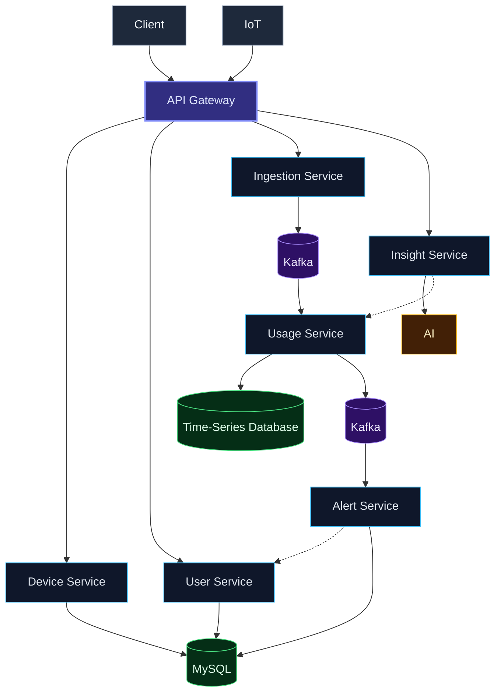

# Home Energy Tracker — Architecture

> **Conceptual architecture.** This diagram represents the target design of the system as specified in the reference diagram. It is not a claim that every component or connection is currently implemented.

## Diagram

## Legend

| Arrow               | Meaning                                                       |
| ------------------- | ------------------------------------------------------------- |
| `A --> B` (solid)   | Primary connection between components                         |
| `A -.-> B` (dashed) | Secondary / cross-service relationship (shown dashed in the reference) |

## Flow summary

1. **Client** and **IoT** connect to the **API Gateway**
2. **API Gateway** connects to **Device Service**, **User Service**, **Ingestion Service**, and **Insight Service**
3. **Device Service** and **User Service** both use **MySQL**
4. **Ingestion Service** flows into **Kafka**, which flows into **Usage Service**
5. **Usage Service** stores data in the **Time-Series Database** and also flows into a second **Kafka**, which flows into **Alert Service**
6. **Insight Service** connects to **AI** and (dashed) to **Usage Service**
7. **Alert Service** connects (dashed) back to **User Service** and also uses **MySQL**
